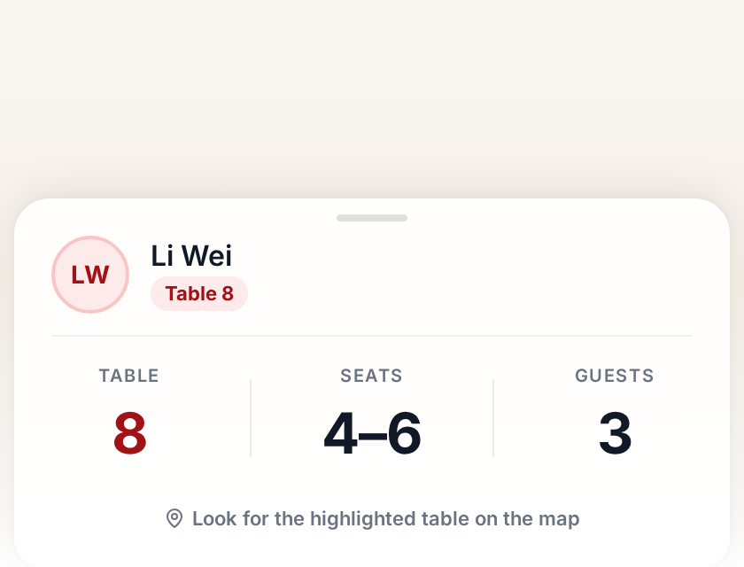

# WeddingDB

  

A free, self-hosted guest list for Chinese wedding receptions. It replaces the printed list at the door with a live copy that staff and guests see on any phone or tablet.

> This project is written with AI agents. If that bothers you, look elsewhere. No hard feelings.



## The door

Two hundred guests arrive in under two hours. The receptionist has one printed list and one pen. A guest gives a name. The receptionist runs a finger down the page, checks whether the guest came, writes a table number, and writes down the red packet. One queue, one desk, one copy of the list. The gift ledger is transcribed by hand after everyone leaves.

WeddingDB puts that list on every screen at the door and keeps one shared copy. A small server runs it. The receptionist searches a name on a phone, taps check-in, and every other phone sees the update.

## What it does

- Searches guests by name, including pinyin, at the door.
- One-tap check-in that updates every screen live.
- Records the red packet (angpao) per guest, then exports CSV or XLSX for thank-you notes.
- Lets the couple draw the real hall on a map (tables, stage, entrances, walkways) and assign tables and seats there.
- Imports a guest list from CSV, up to 1,000 guests per wedding.
- Runs several weddings on one deployment, for planners and venues.

A kiosk mode runs on a tablet. A guest types a name, sees the table and seat range, and walks in. Kiosk settings are per wedding: logo, background, welcome text, whether to show seat numbers, and an idle reset timer.

| Who | What they do |
|---|---|
| Couple or host | Build the guest list, draw the hall, assign tables and seats, watch check-in live |
| Reception team | Work the door: search a name, check the guest in, record the red packet |
| Guests | Use the kiosk: type a name, see the table and seat range, find the table on the map |

## Run it

You need Docker with Compose. The image comes from GitHub Container Registry, so nothing builds locally.

```sh
export JWT_SECRET=$(openssl rand -hex 32)
export POSTGRES_PASSWORD=$(openssl rand -hex 32)
export REDIS_PASSWORD=$(openssl rand -hex 32)
export ADMIN_BOOTSTRAP_PASSWORD='a-strong-one-time-password'
docker compose up -d
```

`JWT_SECRET`, `POSTGRES_PASSWORD`, and `REDIS_PASSWORD` are required. Compose refuses to start without them. `ADMIN_BOOTSTRAP_PASSWORD` is required on first boot and is rejected if left at the placeholder.

| Service | Address |
|---|---|
| WeddingDB (app and API) | `http://localhost:8080`, bound to `127.0.0.1`; put TLS at a reverse proxy |
| PostgreSQL | `localhost:5432`, user, password, and database all `weddingdb`, loopback only |
| Redis (DragonflyDB) | internal to the compose network, no host port |

First login uses `admin@weddingdb.local` and the password in `ADMIN_BOOTSTRAP_PASSWORD`. The first login asks for a new password. Bootstrap runs only when the admin table is empty.

Update with `docker compose pull app && docker compose up -d`.

## Under the hood

- SvelteKit SPA (Svelte 5 runes, Tailwind CSS v4, TypeScript), served by the Go API.
- Go 1.27 REST API (Fuego and GORM) on PostgreSQL.
- Redis (DragonflyDB) for pub/sub and SSE, so a check-in reaches every screen.
- Guest list cached in the browser, so search and check-in keep working when venue WiFi drops.
- Auth: JWT with refresh-token rotation and revocation, role-based admin, rate-limited login. Kiosk access never touches admin access.
- Optional OpenTelemetry tracing to Jaeger, covering requests and DB queries end to end.
- Docker Compose runs `app`, `postgres`, and `redis`. Optional `jaeger` behind the `tracing` profile.

Setup for development, environment variables, and the API reference are in the [developer documentation](docs/dev/README.md). Design decisions are in [docs/adr](docs/adr), and behaviour specs are in [docs/specs](docs/specs).

## License

AGPL-3.0. See [LICENSE](LICENSE).
